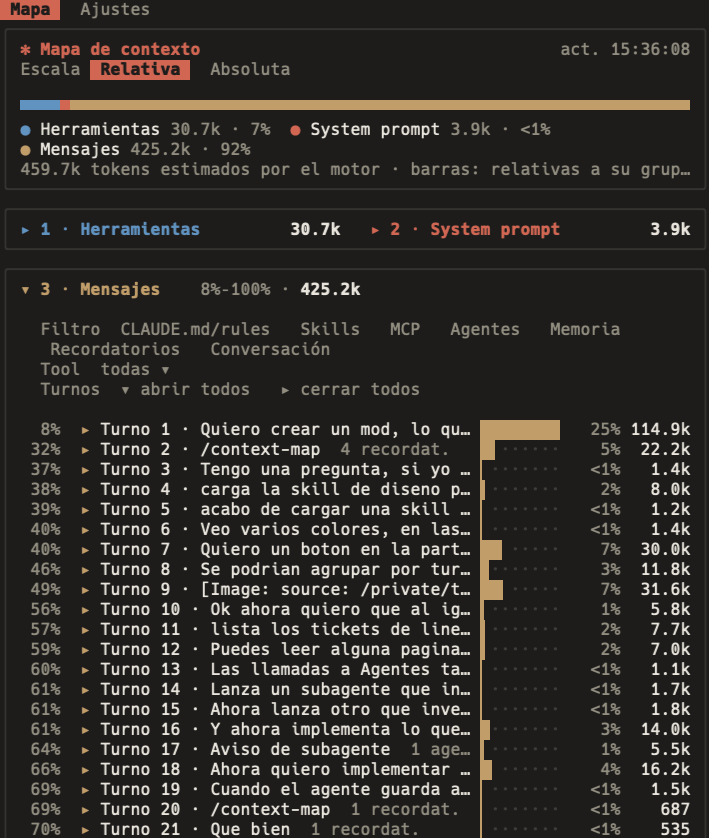

# context-map

Un mod de Claude Code que abre un panel con el **mapa de tu ventana de contexto**: qué está cargado, en qué orden lo lee el modelo y cuánto ocupa cada cosa, turno a turno.



## Instalación

En una sesión de Claude Code, en la terminal:

```
/plugin install context-map --marketplace jlsaco/claude-context-map
```

Responde `y` para añadir el marketplace y elige el ámbito (usuario por defecto). Desde la línea de comandos es equivalente:

```
claude plugin install context-map --marketplace jlsaco/claude-context-map
```

Requiere Claude Code 2.1.295 o posterior (mods con function hooks).

## Uso

`/context-map` abre el panel. Tiene dos pestañas.

### Mapa

Las tres zonas del request, en el orden en que viajan:

1. **Herramientas**: definiciones integradas y MCP con esquema cargado; las diferidas tras ToolSearch solo cuentan su nombre.
2. **System prompt**: cada sección, con el límite de caché entre lo compartido y lo propio de la sesión.
3. **Mensajes**, agrupados por turno:
   - contexto inicial: cada `CLAUDE.md` y rule, por archivo y tipo (usuario, proyecto, local)
   - skills cargadas y los archivos de su carpeta que se leyeron
   - llamadas MCP numeradas en orden, y un ranking por tokens devueltos
   - subagentes: el encargo, el informe donde llegó y su contexto propio (que no ocupa tu ventana)
   - memoria guardada, editada, leída o recordada
   - recordatorios del sistema y conversación

Cada fila muestra su posición en el contexto (%), una barra, su parte del total y sus tokens. Con el panel abierto, los totales de cada zona se cuentan como en `/context`; las filas se reparten en proporción a su tamaño.

- **Escala**: *Relativa* compara cada fila con su grupo; *Absoluta* lo mide todo contra la ventana, con el espacio libre y la marca del autocompactado.
- **Crecimiento por turno**: cuánto añadió cada turno y cuántos turnos quedan antes del autocompactado al ritmo actual.
- **Filtros**: por tipo (CLAUDE.md/rules, skills, MCP, agentes, memoria, recordatorios, conversación) y por una tool o tipo de agente concreto. La posición sigue siendo la real.

### Ajustes

Tema (Auto, Claude, Sistema), animaciones, qué resúmenes y filtros se muestran, el detalle de las filas, el ranking MCP y si se cuenta con la API. Se guardan entre sesiones.

## Desarrollo

```
claude plugin validate .
claude plugin test .
```

Para probar cambios sin instalar: `claude --plugin-dir .`. Una instalación desde un marketplace, incluso uno local (`claude plugin marketplace add <carpeta>`), usa una copia en caché por versión: sube `version` en `plugin.json` y ejecuta `claude plugin marketplace update claude-context-map` y `claude plugin update context-map@claude-context-map`.

## Licencia

MIT
